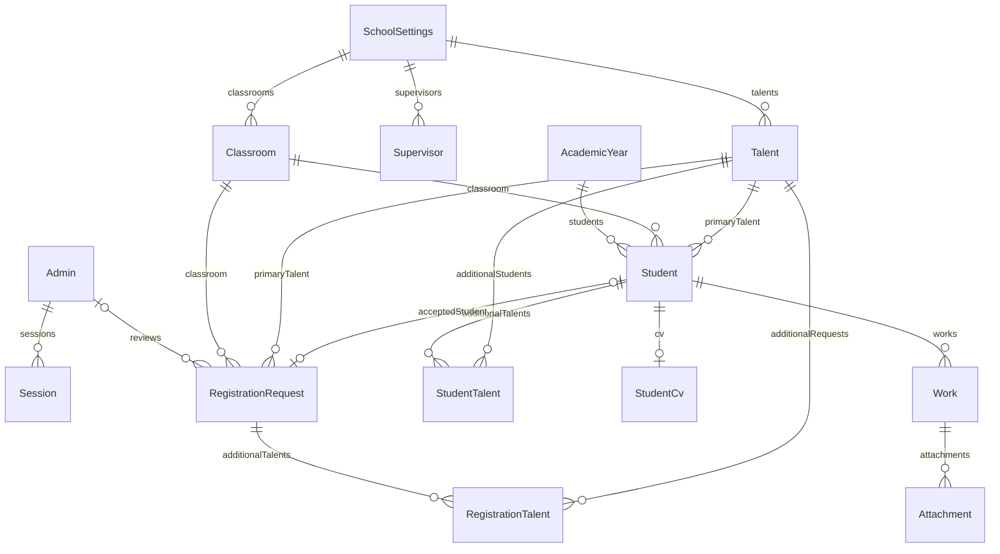

# خطة قاعدة البيانات للمراجعة قبل التنفيذ

**تحديث 2026-10-12:** وافق صاحب المشروع على الخطة والنشر. نُفذت العلاقات وسجل المراجعة والقيود والفهارس المحددة في ترحيل إضافي، واختُبرت ترقية نسخة مسترجعة. قياس GIN لم يثبت فائدة في البيئة المعزولة، فلم يُضف إلى الإنتاج. التفاصيل والحدود في `RELEASE_2026-10-12.md`. بقية النص يحفظ سياق الخطة الأصلية.

لم يُغيَّر مخطط Prisma أو تُضاف ترحيلات في مرحلة تنظيم المصدر. ترحيل `202610120001_school_name_phone` وتعديلات اسم المدرسة ورقم الجوال كانت موجودة عند بدء هذه المرحلة وحُفظت كما هي. استُخدمت الترحيلات في قاعدة اختبار مؤقتة فقط؛ لا تعني نتائج الاختبارات تطبيقها على التطوير أو الإنتاج.

## نموذج العلاقات الحالي

`StorageDeletion` قائمة مستقلة بمفاتيح الملفات المطلوب حذفها، وتبقى حتى نجاح الحذف الفعلي.

## قواعد يجب الحفاظ عليها

- سنة مفتوحة واحدة، مفروضة بفهرس جزئي في SQL.
- الطالب المؤرشف في الثالث وله تاريخ أرشفة؛ الطالب النشط دون تاريخ أرشفة.
- الفصل والموهبة مستخدمان بمعرّفات ومفاتيح أسماء مطبعة؛ تعطيلهما يحفظ العلاقات السابقة.
- اعتماد الطلب نفسه يعيد الطالب الموجود. حذف الطالب يترك سجل القبول مع ارتباط فارغ ولا يعيد إنشاء الطالب.
- الجوال وسيلة اتصال، وليس هوية فريدة؛ قد يشترك أكثر من طالب في رقم ولي أمر. لا يُضاف قيد فريد على الاسم أو الجوال تلقائيًا.
- المسودة والمعتمد ولقطات الهوية منفصلة. PDF يخرج من المعتمد، واللقطة تاريخية.
- الجداول والمرفقات خاصة، ووصول الواجهة يمر بالخادم. لا تُفتح سياسات Supabase للطلاب ضمن هذه الخطة.

## التعديلات المقترحة التي تحتاج الموافقة

| الجزء           | التغيير                                                           | سياسة البيانات القديمة                                                     | اختبار القبول                                                |
| --------------- | ----------------------------------------------------------------- | -------------------------------------------------------------------------- | ------------------------------------------------------------ |
| التسجيل المتكرر | مفتاح لإعادة محاولة الإرسال وتنبيه للطلبات المتشابهة              | لا حذف ولا دمج تلقائي للطلبات أو الطلاب                                    | إرسال متزامن وإعادة محاولة بعد فقد الاستجابة دون إنشاء طلبين |
| سنة تقديم الطلب | علاقة بين الطلب والسنة التي قُدم فيها                             | لا نستنتج السنة القديمة من التاريخ وحده؛ نعرض السجلات غير المحددة للمراجعة | قبول طلب سابق يتطلب تأكيد الصف والسنة المستهدفة              |
| أثر حذف الطالب  | حدث يوضح إزالة الطالب المرتبط مع إبقاء سجل القبول                 | لا إعادة إنشاء للطالب ولا تغيير الموافقة السابقة                           | تظهر حالة الطلب بوضوح بعد حذف الطالب                         |
| مراجعة السيرة   | سجل المراجع والنسخة والتاريخ، وتوثيق مراجعة الطالب بإشراف المدرسة | السير السابقة تبقى قابلة للقراءة مع توضيح غياب سجل المراجعة القديم         | الاعتماد مرتبط بالنسخة المراجعة ويُمنع بعد تغيرها            |
| الفهارس         | فهرس `RegistrationRequest.reviewedById`، وقياس فهرس البحث الجزئي  | إضافات لا تغير المحتوى، مع تقدير أثر بنائها                                | مقارنة خطة الاستعلام على بيانات ممثلة                        |

سجل التحاق الطالب في كل سنة، وربط الإنجازات بأدلة، وإدارة مقترحات الكتالوج ميزات إضافية مستقلة. تُختار بعد تحديد الحاجة؛ لا تدخل تلقائيًا في الإصلاحات.

## خطوات التنفيذ بعد الموافقة

1. إعادة فحص حالة القاعدة المستهدفة والترحيلات والقيود، وتحديد السجلات التي تحتاج معالجة دون عرض معلوماتها الخاصة.
2. نسخة احتياطية للقاعدة والمرفقات واختبار استرجاع في بيئة معزولة.
3. ترحيل إضافي لكل تغيير متفق عليه؛ لا تعديل لترحيل مطبق ولا إعادة بناء جداول الإنتاج.
4. اختبار ترقية بيانات قديمة وبيانات جديدة، والمعاملات والتكرار والحذف والخصوصية.
5. عرض أثر الترحيل والنتائج قبل تطبيقه على القاعدة الفعلية. النشر يحتاج إذنًا مستقلًا.
